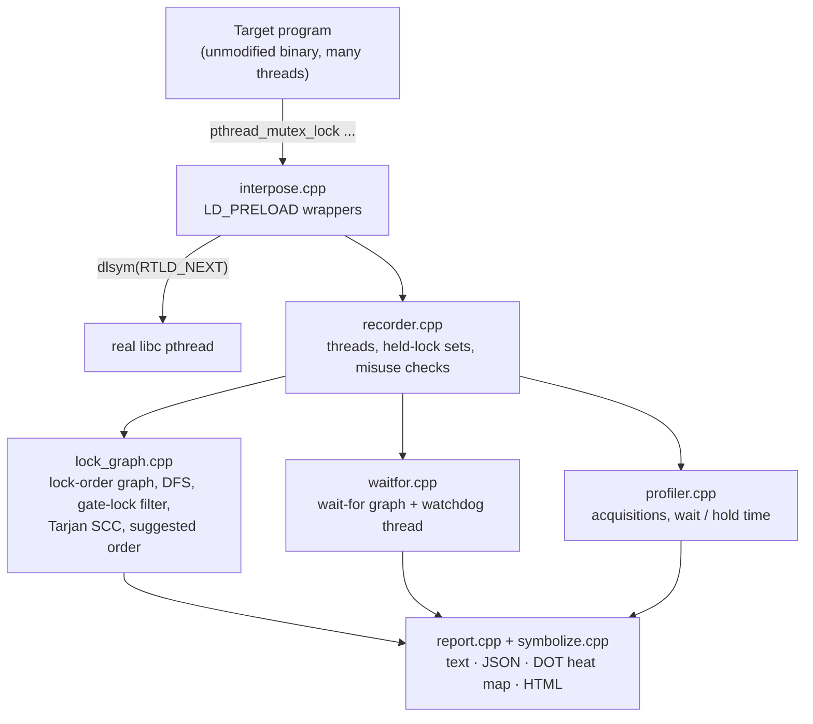

# LockSpy

**A runtime deadlock and lock-contention detector for unmodified multithreaded C/C++ programs on Linux.**

LockSpy is a shared library you preload into any dynamically linked pthread program — no source
changes, no recompile. It watches every mutex, rwlock and condition-variable call, builds a
lock-order graph (the idea behind the Linux kernel's lockdep, applied to user space) and a live
wait-for graph, and tells you three things: *this program can deadlock* (even if this run did not
hang), *this program is deadlocked right now*, and *this is the lock order that fixes it*. It also
catches lock misuse and ranks locks by contention.

OS Lab project (24B11CS312), B.Tech III year, JIIT, session 2026-27 — Prakhar Agnihotri,
Shreesh Goyal, Unnati Joshi, Pragya Sumbly.

## Demo

`tests/buggy/ab_ba.cpp`: thread P locks A then B, thread Q locks B then A. The run finishes
normally, yet LockSpy reports (real captured output):

```
$ ./bin/lockspy run -- ./build/tests/buggy/ab_ba
[LockSpy] POTENTIAL DEADLOCK: lock-order cycle detected  (#1, t=0.000s)
  Lock A -> Lock B   taken by thread P in worker_p() (ab_ba.cpp:21)
  Lock B -> Lock A   taken by thread Q in worker_q() (ab_ba.cpp:32)
  Suggested fix: acquire A before B in every thread.
    change worker_q() (ab_ba.cpp:32): it takes A while holding B
  Coffman conditions (a deadlock needs all four):
    ✔ Mutual exclusion  A, B are mutexes, only one owner at a time
    ✔ Hold and wait     P holds A while requesting B; Q holds B while requesting A
    ✔ No preemption     a pthread lock is never taken away; only its owner can unlock it
    ✔ Circular wait     P -> B -> Q -> A -> P   (possible; it did not have to happen in this run)
  Call stacks:
    thread P (T1, started in worker_p()) requesting B:
      #0 worker_p() (ab_ba.cpp:21)
    thread Q (T2, started in worker_q()) requesting A:
      #0 worker_q() (ab_ba.cpp:32)
```

With `--hang` the same program is forced into the bad interleaving, and the watchdog confirms the
prediction:

```
[LockSpy] LIVE DEADLOCK: 2 threads are blocked in a wait-for cycle  (#2, t=1.002s)
  thread P holds Lock A and waits for Lock B (owner: thread Q), blocked 1.00s in worker_p() (ab_ba.cpp:21)
  thread Q holds Lock B and waits for Lock A (owner: thread P), blocked 1.00s in worker_q() (ab_ba.cpp:32)
  ...
    ✔ Circular wait     P -> B -> Q -> A -> P   (happening now)
  This hang was predicted at t=0.000s (finding #1).
  Suggested fix: acquire A before B in every thread.
```

## Quick start

On Ubuntu (needs `g++`, `make`, `binutils`; optional `graphviz`, `valgrind`, `python3`):

```bash
make && ./bin/lockspy run -- ./build/tests/buggy/ab_ba
make test        # 18 test runs, PASS/FAIL table
make demo        # JSON + DOT + HTML report, PNG/SVG graph if Graphviz is installed
make bench       # LockSpy vs ThreadSanitizer vs Helgrind -> results/RESULTS.md
make memcheck    # LockSpy itself under Valgrind
```

On macOS (no `LD_PRELOAD`, no `/proc`), use the bundled Ubuntu container:

```bash
docker build -t lockspy-dev docker/
docker run --rm -it --security-opt seccomp=unconfined -v "$PWD":/lockspy lockspy-dev
```

Use it on your own program (compile with `-g` for file:line, `-rdynamic` helps naming):

```bash
./bin/lockspy run --format text,json,dot,html --outdir out -- ./your_app args
LD_PRELOAD=$PWD/build/libLockSpy.so ./your_app            # the same thing, by hand
```

| option | environment variable | default |
|---|---|---|
| `--format text,json,dot,html` | `LOCKSPY_FORMAT` | `text` |
| `--outdir DIR` | `LOCKSPY_OUTDIR` | `.` |
| `--depth N` | `LOCKSPY_STACK_DEPTH` | 8 |
| `--top N` | `LOCKSPY_TOP` | 5 |
| `--watchdog MS` (0 = off) | `LOCKSPY_WATCHDOG_MS` | 500 |
| `--on-deadlock report\|abort` | `LOCKSPY_ON_DEADLOCK` | `report` |
| `--names FILE` (`file.cpp:LINE = name` or `function = name`) | `LOCKSPY_NAMES` | – |
| `--naive` (filters off, for comparison) | `LOCKSPY_NAIVE` | off |
| `--trace` (print every event) / `--quiet` | `LOCKSPY_TRACE` / `LOCKSPY_QUIET` | off |

## Architecture



## Features

- **Interception** of `pthread_mutex_{lock,trylock,timedlock,unlock,init,destroy}`,
  `pthread_rwlock_*`, `pthread_cond_{wait,timedwait}`, `sem_{wait,trywait,timedwait,post}`,
  `pthread_create`, `pthread_exit`. Thread-safe, never re-enters itself, survives `fork()`.
- **Potential deadlocks** from the lock-order graph (DFS on every new edge), reported even if the run never hung.
- **Live deadlocks** from the wait-for graph, found by a watchdog thread; optional `abort()`.
- **Predict-then-confirm**: a live hang is linked to the earlier potential report ("predicted at t=…").
- **Fewer false positives**: cycles taken under a common *gate lock*, by a *single thread*, or
  needing a *reader to wait for a reader* are suppressed and counted; trylock adds no edge.
- **A concrete fix**: Tarjan SCC + greedy ordering gives a global lock order (`A < B < C`) and the
  exact call sites that violate it.
- **Coffman proof**: every deadlock report shows evidence for the four necessary conditions.
- **Misuse**: relock of a non-recursive mutex (recursive mutexes understood), unlock of a lock
  not held, lock still held at thread exit — each with a stack trace.
- **Contention profiler**: per lock acquisitions, contended acquisitions, total/max wait and hold
  time, ranked; condition-variable sleep and semaphore waits separately.
- **Readable names**: `A`, `forks[3]`, `mutex@bank.cpp:12`, thread names from `/proc/.../comm`.
- **Reports**: text, JSON, Graphviz DOT heat map (cycle edges red, suppressed edges dashed grey), self-contained HTML.

## Results

Measured with `make bench` (Ubuntu 24.04, g++ 13.3, 4-CPU aarch64 VM). Full tables, per-program
verdicts and caveats: [results/RESULTS.md](results/RESULTS.md).

**Detection** over 9 buggy and 7 correct/tricky programs:

| tool | caught | missed | false alarms | precision | recall | recompile needed |
|---|---|---|---|---|---|---|
| **LockSpy** | 9 | 0 | 0 | 1.00 | 1.00 | no |
| LockSpy `--naive` (filters off) | 9 | 0 | 3 | 0.75 | 1.00 | no |
| ThreadSanitizer | 6 | 3 | 2 | 0.75 | 0.67 | yes |
| Valgrind Helgrind | 8 | 1 | 3 | 0.73 | 0.89 | no |

The three false alarms LockSpy avoids are exactly the `tricky/` programs (gate lock, trylock
back-off, one thread using both orders). ThreadSanitizer missed the 5-thread philosophers hang,
the relock and the lock held at thread exit; Helgrind missed the philosophers hang.

**Overhead** (wall clock, median of 5 runs):

| program | bare | LockSpy | ThreadSanitizer | Helgrind |
|---|---|---|---|---|
| uncontended lock/unlock loop, 4 threads × 1M | 0.128 s | 6.8× | **2.6×** | 176.5× |
| contention_heavy, 8 threads | 0.011 s | **1.9×** | 2.6× | 51.9× |
| geometric mean over 6 programs | – | **3.1×** | 4.3× | 122.5× |

About 185 ns extra per uncontended lock+unlock pair. ThreadSanitizer is faster than LockSpy on the
tight uncontended loop, because LockSpy serialises all threads' lock events on one private lock;
LockSpy is faster on the other five programs and needs no recompile.

## Limitations (honest)

- pthread only. C++ `std::mutex`, `std::shared_mutex` and `std::condition_variable::wait` work
  because they are built on pthread; `wait_for`/`wait_until` (which use `pthread_cond_clockwait`)
  and `pthread_mutex_clocklock` are not intercepted yet.
- Semaphores are profiled but cannot be part of a deadlock report (a semaphore has no owner).
- Only locks taken through calls that go through the dynamic linker are seen: not libc's internal
  locks, not statically linked programs, not spinlocks or lock-free code (out of scope).
- A dynamic tool: it finds lock-order bugs on paths the run executed, not on every possible path.
- All threads briefly serialise on LockSpy's one private lock, so very lock-heavy code slows down
  (see the overhead table).

## How it maps to the OS course

| Module | Topic | Where in LockSpy |
|---|---|---|
| I | Linux / Unix environment | shell wrapper `bin/lockspy`, `LD_PRELOAD`, Makefile, `/proc/self/task/<tid>/comm`, `/proc/self/exe` |
| II | Processes, dynamic linking, IPC | symbol interposition, `dlsym(RTLD_NEXT)`, constructors, `fork` handling, `posix_spawn` + pipes for `addr2line`/`nm` |
| III | POSIX threads | per-thread held-lock sets, thread-local storage, `pthread_create` trampoline, watchdog thread |
| V | Process synchronization | mutexes, rwlocks, condition variables (monitors), semaphores; Dining Philosophers, Producer–Consumer, Readers–Writers |
| VI | Deadlock management | Coffman conditions, lock-order and wait-for graphs, DFS cycle detection, prevention by ordering, recovery by abort |

## Documentation

- [docs/EXPLAIN.md](docs/EXPLAIN.md) — viva guide: 2-minute pitch, code walkthrough, 15 Q&A, demo script
- [docs/DESIGN.md](docs/DESIGN.md) — design decisions and tricky problems
- [docs/RESUME.md](docs/RESUME.md) — resume bullets and pitch
- [results/RESULTS.md](results/RESULTS.md) — full measured results
